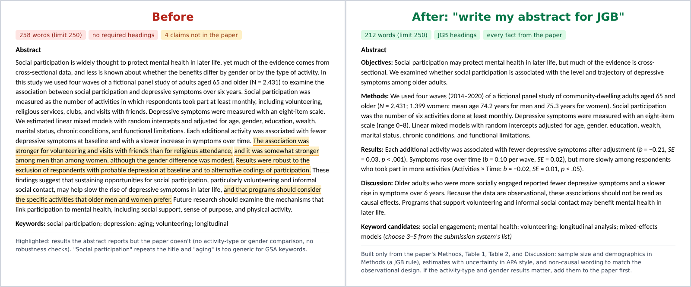
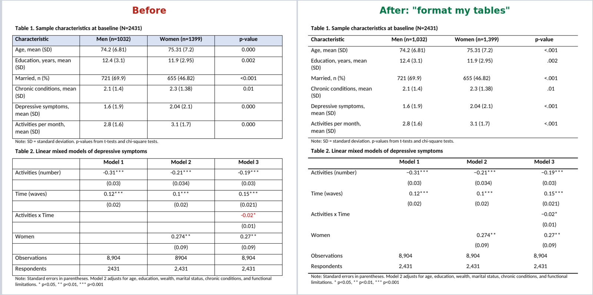

# Academic Paper Formatting Skills for Claude

Three free [Claude skills](https://support.claude.com/en/articles/12512180-use-skills-in-claude) that help researchers prepare a manuscript for submission, and revise it after peer review, for these journals:

| Skill | Journals |
|---|---|
| **`jama-manuscript-prep`** | JAMA Network journals: *JAMA*, *JAMA Network Open*, *JAMA Internal Medicine*, *JAMA Neurology*, *JAMA Psychiatry*, *JAMA Health Forum*, and the other JAMA specialty journals |
| **`gsa-manuscript-prep`** | Gerontological Society of America journals: *Journals of Gerontology Series A* (Biological or Medical Sciences), *Series B* (Psychological or Social Sciences), *The Gerontologist*, *Innovation in Aging*, *Public Policy & Aging Report* |
| **`sociology-manuscript-prep`** | Sociology and demography journals: *American Sociological Review*, *American Journal of Sociology*, *Social Forces*, *Socius*, *European Sociological Review*, *British Journal of Sociology*, *Journal of Health and Social Behavior*, *Social Science & Medicine*, *SSM - Population Health*, *SSM - Mental Health*, *Sociology of Health & Illness*, *Demography*, *Population and Development Review*, *Population Research and Policy Review*, *Advances in Life Course Research*, *Social Science Research*, *Research in Social Stratification and Mobility*, *Sociological Methodology*, *Sociological Methods & Research*, *Sociology of Race and Ethnicity* |

**Download:** [jama-manuscript-prep.zip](https://github.com/JYU-412/Academic-paper-formatting-skill/raw/main/dist/jama-manuscript-prep.zip) · [gsa-manuscript-prep.zip](https://github.com/JYU-412/Academic-paper-formatting-skill/raw/main/dist/gsa-manuscript-prep.zip) · [sociology-manuscript-prep.zip](https://github.com/JYU-412/Academic-paper-formatting-skill/raw/main/dist/sociology-manuscript-prep.zip)


## What's new

**October 22, 2026**

- **Before-and-after example:** see the abstract writer, the checks, and the table formatter at work on a fictional gerontology paper (below).
- **Requirements file:** [requirements.md](requirements.md) lists the Python version (3.8+) and the one dependency (lxml), for anyone running the scripts or adapting the skills for their own agent setup.
- **More accurate table handling:** standard errors in parentheses now line up on the decimal point, and sentences such as "Table 1 shows…" are no longer mistaken for table titles.

**October 21, 2026**

- **New sociology and demography skill** for 20 journals, including ASR, AJS, Social Forces, JHSB, Demography, PRPR, the SSM journals, and Sociology of Race and Ethnicity. Every journal's rules were checked against its own author guide.
- **Formatting checks:** a page layout and heading checker (font, spacing, margins, page numbers, page breaks, notes, heading levels) and a table checker (vertical lines, shading, decimal places, P values, minus signs).
- **Table formatter, on request:** say *"format my tables"* to get a copy of your manuscript with journal-style tables, including decimal alignment, with fixes as tracked changes. Your numbers and original file are never changed.
- **Journal-specific word counts:** choose what counts toward the limit (text, notes, references, abstract, tables), since journals differ.

---

## What this is

A *skill* is a set of instructions that Claude loads when it's relevant. Once installed, you can upload your manuscript and say something like *"get this ready for JAMA Network Open"* or *"check my paper against The Gerontologist's requirements"*, and Claude follows a checklist built from each journal's own Instructions for Authors.

Each skill covers the whole path from draft to accepted paper:

- **Preparing:** a requirements card for your journal and article type; an abstract generated automatically from your manuscript's content, with the journal's required headings and word limit; Key Points (JAMA) or keywords and the Translational Significance statement (GSA), also drafted from your content; and a section-order check
- **Polishing:** AMA or APA style, table and number formatting (an automatic table checker, plus an optional table formatter that fixes your tables in a copy of the file), a page layout and heading check, number consistency across abstract, text, and tables, causal-language checks for observational designs, and a light clarity edit in your own voice
- **Fitting the limits:** an exact word-count dashboard, trim-to-fit suggestions with every cut tracked, and ideas for what to move to the supplement
- **Submitting:** reporting-guideline mapping (STROBE, CONSORT, PRISMA, and others), reference checks, title page and required statements, an anonymization check for blinded files (GSA), cover letter, and a mock peer review
- **Revising:** a point-by-point response-to-reviewers table, and retargeting to another journal after a rejection

## Why use it

- **Fewer desk rejections for format.** Word limits, missing Key Points, wrong abstract headings, ageist terms, or a missing Data Availability statement can get a paper returned before review. The skill checks all of these against current rules.
- **Accurate word counts.** The built-in counter applies each journal's own definition of what counts: main text only (JAMA, JGB, *The Gerontologist*, *Innovation in Aging*), title page and abstract included (JGA), or references included (PPAR). It also counts tracked changes from co-authors as accepted, which Word's own counter on a draft with unaccepted changes won't do.
- **Tables checked cell by cell.** A built-in table checker flags vertical lines, shading, values lined up with tabs or stacked with line breaks, empty cells, mixed decimal places, percentages with decimals in small groups (JAMA), hyphens used as minus signs, ±, P values like 0.001 or .000, and symbol footnote markers, following AMA (JAMA, JGA) or APA (JGB, *The Gerontologist*, *Innovation in Aging*, PPAR) conventions.
- **Page layout and headings checked.** The layout checker reads your file the way Word renders it and reports font and size, double spacing, margins, justification, page and line numbers, missing page breaks before sections and tables, footnotes (not allowed at GSA journals), heading levels (APA 7 for GSA journals), leftover tracked changes and comments, and your name in the file properties of a blinded manuscript.
- **Tables formatted for you, if you ask.** Say *"format my tables"* and the skill writes a new copy of your manuscript with horizontal rules only, no shading, a repeating header row, APA alignment where it applies, and P values, minus signs, and number separators fixed as tracked changes you can accept or reject. It never changes your numbers, and it writes a change log. Your original file is never touched.
- **Your voice stays yours.** Edits and trims cut redundancy before rewriting, reuse your own phrasing, and come with a change log or Word comments, so you accept or reject each change.
- **Nothing invented.** Abstracts, Key Points, and responses are built only from what's in your manuscript or what you say. Missing details become placeholders like `[CI NEEDED]`, never made-up numbers.
- **Pick only what you need.** Each run starts with a menu grouped by stage, so a quick abstract check doesn't turn into a full review.

## How to install

### Option A: Claude app (web or desktop)

Available on Free, Pro, Max, Team, and Enterprise plans.

1. Download the skill(s) you need: [jama-manuscript-prep.zip](https://github.com/JYU-412/Academic-paper-formatting-skill/raw/main/dist/jama-manuscript-prep.zip), [gsa-manuscript-prep.zip](https://github.com/JYU-412/Academic-paper-formatting-skill/raw/main/dist/gsa-manuscript-prep.zip), [sociology-manuscript-prep.zip](https://github.com/JYU-412/Academic-paper-formatting-skill/raw/main/dist/sociology-manuscript-prep.zip) (also in the [`dist/`](dist) folder). Don't unzip them.
2. In Claude, open **Settings → Capabilities** and turn on **Code execution and file creation**. The skills need it to read Word files and run the word counter.
3. Go to **Customize → Skills**.
4. Click **+**, then **+ Create skill**, then **Upload a skill**, and choose the ZIP file.
5. Make sure the skill's toggle is on. Repeat for each skill you want.

On Team and Enterprise plans, an organization owner may need to enable code execution and skills first, under **Organization settings → Plugins & skills**. See Anthropic's guide: [Use skills in Claude](https://support.claude.com/en/articles/12512180-use-skills-in-claude).

### Option B: Claude Code

Copy the skill folders into your personal skills directory:

```bash
git clone https://github.com/JYU-412/Academic-paper-formatting-skill.git
mkdir -p ~/.claude/skills
cp -r Academic-paper-formatting-skill/skills/* ~/.claude/skills/
```

To share them with a project team instead, copy them into `.claude/skills/` inside the project repository. See [Claude Code skills docs](https://code.claude.com/docs/en/skills).

## How to use it, step by step

1. **Start a new chat** and attach your manuscript (.docx works best; .pdf or pasted text also work).
2. **Say what you want and where you're submitting.** Examples:
   - *"Get this ready for JAMA Network Open as an Original Investigation."*
   - *"I'm submitting to JGB Social Sciences. Check the word count and draft the abstract."*
   - *"Write the Translational Significance statement for Innovation in Aging."*
   - *"Here are the reviewer comments from The Gerontologist. Draft a response table."*
   - *"Check my page layout and headings for JGB, then format my tables."*
   - *"Check this against ASR's requirements, counting notes and references toward the limit."*
   - In Claude Code you can also type `/jama-manuscript-prep`, `/gsa-manuscript-prep`, or `/sociology-manuscript-prep`.
3. **Confirm the basics.** Claude infers the journal, section, article type, and study design from your message and manuscript, and asks only about what's missing.
4. **Pick from the menu.** If your request was general, Claude shows the menu by stage (Preparing, Polishing, Fitting the limits, Submitting, Revising). Reply with numbers ("1, 9, 10"), a stage ("all of Submitting"), or "everything".
5. **Review the output.**
   - Checks come back as a short report sorted into *must fix*, *should fix*, and *optional*.
   - New text (abstract, Key Points, statements, cover letter) comes ready to paste, with its word count and any placeholders.
   - For edits to a Word file, you get a copy of your manuscript with tracked changes or Word comments, so nothing in your original is overwritten.
6. **Fill the placeholders and decide the open items.** Each run ends with a list of what only you can supply or decide.
7. **Come back at the revision stage** with the decision letter. The same skill handles the response to reviewers and re-checks the limits on the revised file.

### Example: what a check looks like

> **Verdict:** main text is 3412 words, over the 3000-word limit by 412; abstract and Key Points are missing.
>
> **Must fix:** add Key Points (75-100 words) and a structured abstract (≤350 words, with Design, Setting, and Participants as separate headings at submission); shorten the title from 128 to ≤100 characters; one P value is above the stated multiple-testing threshold but is described as significant (please check).
>
> **Should fix:** state how race and ethnicity were determined; give the R version; AMA formatting of statistics.
>
> **Trim suggestions:** 14 Word comments saving about 450 words, each with replacement text built from your own sentences.

### Example: before and after

A fictional gerontology paper (invented data, written to include common problems) prepared for *JGB Social Sciences*.

**Abstract, generated from the paper's content.** The original abstract was over the limit, had no headings, and reported results that appear nowhere in the paper. The new one uses JGB's headings, reports the main estimates with their uncertainty, matches the observational design, and draws every fact from the paper.



**Tables, formatted on request.** The table formatter rebuilt both tables in journal style: horizontal rules only, no shading or colored text, P values like `0.000` changed to `<.001`, true minus signs, thousands separators, and numbers lined up on the decimal point, including the standard errors in parentheses.



The checks on the same file also flagged what the formatter leaves to you:

> **Word count:** abstract 258 words, over the 250-word limit by 8; main text within the limit.
>
> **Page layout (journal requirements):** Calibri 11 instead of Times New Roman 12; single instead of double spacing; 0.75-inch margins instead of 1 inch; abstract, references, and each table not starting on a new page.
>
> **Tables:** mixed decimal places in the same column (75.31 next to 2.3); empty cells to fill with an em dash; APA table titles (bold number on one line, italic title on the next).

Files: [before](examples/demo_before.docx), [after, with tracked changes](examples/demo_tables_after.docx), and the [change log](examples/demo_tables_after.changes.md).

## The word counters, checkers, and table formatter (optional, no Claude needed)

These tools are embedded in each `SKILL.md`, and also provided as standalone Python scripts in [`scripts/`](scripts) for anyone who wants a quick check. They need Python 3.8 or later and `lxml` (`pip install -r requirements.txt`); see [requirements.md](requirements.md).

```bash
# JAMA Network Original Investigation
python scripts/jama_count.py manuscript.docx --text-limit 3000 --abstract-limit 350 --kp-limit 100 --display-limit 5 --ref-limit 75

# JGB Social Sciences, quantitative Research Article
python scripts/gsa_count.py manuscript.docx --mode text --text-limit 5000 --abstract-limit 250 --display-limit 5 --ref-limit 50

# JGA Medical Sciences (title page + abstract count toward the limit)
python scripts/gsa_count.py manuscript.docx --mode text+front --text-limit 5200

# ASR: text, notes, and references count toward 15,000 words; each note <= 100 words
python scripts/soc_count.py manuscript.docx --count text,notes,refs --text-limit 15000 --abstract-limit 200 --kw-min 4 --kw-max 5 --note-max 100

# Innovation in Aging, checking the anonymized file for author names
python scripts/gsa_count.py blinded.docx --text-limit 6000 --statement-limit 100 --authors "Surname1;Surname2"
```

```bash
# Table formatting check: AMA for JAMA Network, APA for JGB / The Gerontologist / Innovation in Aging / PPAR
python scripts/table_check.py manuscript.docx --style ama
python scripts/table_check.py manuscript.docx --style apa
python scripts/table_check.py manuscript.docx --style ama --allow-asterisks   # JGA
python scripts/table_check.py manuscript.docx --style asa --decimal-align     # JHSB and other ASA journals

# Page layout and headings: jama, jga, jgb, tg, ia, ppar, asr, ajs, sf, socius, esr, bjs, jhsb, ssm, demography, prpr, smr, smx, sre, ... (add --blinded for the anonymized file)
python scripts/layout_check.py manuscript.docx --journal jgb --blinded

# Format tables into a NEW file, with text fixes as tracked changes and a change log
python scripts/table_format.py manuscript.docx --style ama -o manuscript_tables.docx
python scripts/table_format.py manuscript.docx --style apa -o manuscript_tables.docx
python scripts/table_format.py manuscript.docx --style asa --decimal-align -o manuscript_tables.docx
```

The counters detect sections from standard headings, so check the "Sections found" line in the output. If a draft has no Introduction heading, the long paragraphs before Methods are counted as the Introduction.

## Main limits at a glance (checked October 2026)

| Journal | Main research article | What counts | Abstract | Ref style |
|---|---|---|---|---|
| JAMA Network Open, JAMA Internal Medicine | 3000 words, ≤5 tables + figures | main text | 350, structured + Key Points | AMA 11 |
| JGA Biological Sciences | 5800 | title page + abstract + text | 250, unstructured | AMA 11 |
| JGA Medical Sciences | 5200 | title page + abstract + text | 250, structured | AMA 11 |
| JGB Psychological Sciences | 5000 | main text | 250, structured | APA 7 |
| JGB Social Sciences | 5000 (6000 qualitative or mixed) | main text | 250, structured | APA 7 |
| The Gerontologist | 6000 (7000 qualitative, mixed, intervention) | main text | 250, structured | APA 7 |
| Innovation in Aging | 6000 + 100-word Translational Significance | main text | 250, structured | APA 7 or AMA 11 |
| Public Policy & Aging Report | 3500 (Policy Analysis) | text + references | — | APA 7 |
| American Sociological Review | 15,000 | text + notes + references | 150-200 | ASA 7 |
| Social Forces | 10,000 (≤10 tables and figure panels) | text + endnotes + references | no limit stated | Chicago author-date |
| Journal of Health and Social Behavior | 10,000 | text + notes + references | <150 | ASA 7 |
| Demography | 8,000 (≤8 tables + figures) | main text | ≤200 + 3-5 highlights | APA-based |
| Population Research and Policy Review | 8,000-10,000 | main text | 150-250 | APA 7 + PRPR rules |
| European Sociological Review | ~8,000 | text + endnotes + references | ≤200 | author-year |

Journals revise their rules. **Each time it runs, the skill fetches the journal's live Instructions for Authors page, and the live page wins over these numbers.** If the page can't be reached, it says so.

## Important notes

- **Disclose AI use.** JAMA Network and GSA journals require you to disclose use of AI tools in preparing a manuscript (GSA journals: in the Methods; JAMA: per the journal's policy). You remain responsible for all content. The skill reminds you once per session when it writes or edits text.
- **References are checked, not written.** JAMA Network asks authors not to use AI to generate or format references. The skill reports problems and points you to your reference manager (for example, switching the Zotero style to AMA 11th or APA 7th).
- **Some article types prohibit AI drafting.** For example, JAMA Internal Medicine doesn't allow AI to draft Viewpoints, Inside Story pieces, or Letters to the Editor. Check before using the drafting features on opinion pieces.
- **Decimal alignment isn't required.** JAMA Network aligns table columns in production and asks authors not to line up numbers with tabs or spaces; APA and the GSA journals center cell entries and don't require decimal alignment. What reviewers and editors do notice is inconsistent decimal places, which the table checker flags.
- **Your science stays your call.** When a check finds a substantive issue (an outcome missing from the abstract, a mismatch between Methods and Results), the skill raises it as a question instead of changing your conclusions.
- **Unpublished data.** Your manuscript is processed by Claude. Check your institution's and funder's policies on sharing unpublished work with AI tools, and your data use agreements (for example, for restricted survey data).
- **Journal rules were checked in October 2026.** Each run still fetches the live author page when it can, and the live page wins. Corrections are welcome as issues.
- **Not affiliated** with the American Medical Association, JAMA Network, the Gerontological Society of America, the American Sociological Association, the Population Association of America, Oxford University Press, or any journal publisher. Journal names are used only to describe compatibility.

## What's in this repository

```
skills/
  jama-manuscript-prep/SKILL.md   JAMA Network skill (self-contained; includes all four tools)
  gsa-manuscript-prep/SKILL.md    GSA journals skill (self-contained; includes all four tools)
  sociology-manuscript-prep/SKILL.md  sociology and demography skill (self-contained; includes all four tools)
scripts/
  jama_count.py                   standalone JAMA word counter
  gsa_count.py                    standalone GSA word counter
  soc_count.py                    standalone sociology word counter (choose what counts)
  table_check.py                  standalone table formatting checker (AMA or APA)
  layout_check.py                 standalone page layout and heading checker
  table_format.py                 standalone table formatter (writes a new file)
examples/                       fictional demo manuscript, before and after
dist/
  jama-manuscript-prep.zip        ready to upload to Claude
  gsa-manuscript-prep.zip         ready to upload to Claude
  sociology-manuscript-prep.zip   ready to upload to Claude
requirements.md                 Python version and dependencies
requirements.txt                for pip install -r
CHANGELOG.md
LICENSE
```

## Feedback and contributions

Found a rule that changed, a journal you'd like added, or a counting error? Please [open an issue](../../issues) with the journal name, the article type, and a link to the relevant Instructions for Authors section. Pull requests are welcome; please keep each skill self-contained in its `SKILL.md`, and update the standalone script to match.

## License

[MIT](LICENSE). Free to use, share, and adapt, with attribution.

## Author

Created by [Jiao Yu](https://github.com/JYU-412). If these skills help with your submission, a star on the repository helps others find them.
